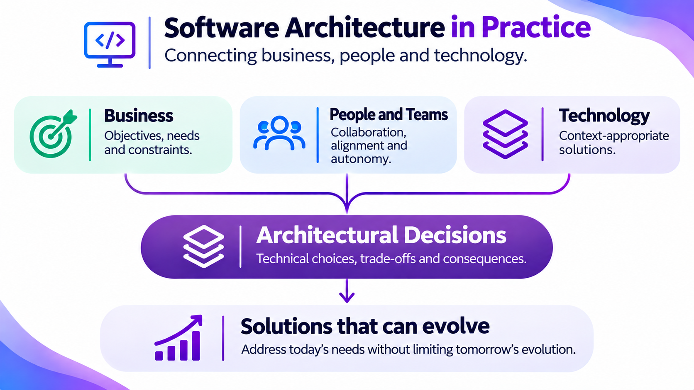

[Português](README.md) | **English** | [Español (Latinoamérica)](README.es.md)
<!-- cspell:words Español Latinoamérica -->

  

# Rodrigo de Oliveira

**Software Architect · Distributed Systems · .NET · Cloud**

I'm a software architect with more than 20 years of experience designing and evolving enterprise systems. I work hands-on with .NET, distributed systems, and cloud platforms, balancing business goals, technical trade-offs, and operational constraints.

This profile highlights open-source tools, libraries, and hands-on labs focused on architecture governance, reliable integrations, and developer workflows.

  <picture>
    <source
      media="(max-width: 767px)"
      srcset="assets/profile/software-architecture-in-practice.en.mobile.png"
    />
    
  </picture>

**Professional links**

- [Professional portfolio](https://rodri-oliveira-dev.github.io/)
- [LinkedIn](https://www.linkedin.com/in/rodri-oliveira-dev)
- [DEV.to](https://dev.to/rodri-oliveira-dev)
- [NuGet](https://www.nuget.org/profiles/rodri-oliveira-dev)

---

## Selected projects

Tools, libraries, and labs that connect architectural decisions to implementation and day-to-day operations.

### [ADR Guard](https://github.com/rodri-oliveira-dev/adr-guard)

*Architecture governance tool*

Helps teams keep architecture decision records (ADRs) consistent and traceable. Its .NET CLI creates, validates, and indexes ADRs. Optional impact and drift analyses rely on clearly scoped evidence and support, rather than replace, architectural judgment. The [case study](https://rodri-oliveira-dev.github.io/en/case-studies/adr-guard/) explores the decisions and trade-offs behind the tool.

### [Dapper.FluentMap](https://github.com/rodri-oliveira-dev/Dapper-FluentMap)

*.NET library*

Maps .NET objects to database columns when Dapper's default conventions fall short, without adding attributes to domain models. Its ongoing development balances a fluent API and extensibility with compatibility for existing applications. The [case study](https://rodri-oliveira-dev.github.io/en/case-studies/dapper-fluentmap/) explores the benefits and limits of this abstraction.

### [Repo2C4](https://github.com/rodri-oliveira-dev/Repo2C4)

*Architecture documentation tool*

Helps keep architecture diagrams aligned with code by generating reviewable C4/LikeC4 documentation from clearly scoped evidence in .NET repositories. Its workflow separates observations from hypotheses and writes files only when explicitly requested. It demonstrates static analysis, deterministic generation, and MCP-based agent integration.

### [POC Arquitetura](https://github.com/rodri-oliveira-dev/poc-arquitetura)

*Distributed-systems lab*

Provides a reproducible .NET microservices environment for exploring eventual consistency, failure handling, and traceability. It uses DDD and asynchronous Kafka integration with the Outbox pattern, alongside tests and runbooks. Proposals not yet supported by code are clearly marked as pending.

### [ReliableWebhooks](https://github.com/rodri-oliveira-dev/ReliableWebhooks)

*.NET integration library*

Addresses failures, concurrent processing, and duplicate requests in outbound webhook delivery. Stable IDs make enqueue operations idempotent. Leases and retries support at-least-once delivery through an application-provided durable store, so receivers still need to handle duplicates. The [case study](https://rodri-oliveira-dev.github.io/en/case-studies/reliable-webhooks/) explains these guarantees and their limits.

### [ComplexityAnalysis.Analyzers](https://github.com/rodri-oliveira-dev/complexity-analyzers)

*Static analysis tool*

Flags potentially costly patterns and complexity regressions during development. When there is enough evidence, the Roslyn analyzer estimates Big-O complexity. It also enforces configurable metrics in builds and IDEs, and reports an unknown result when the code does not support a reliable estimate.

For a broader view, see [Repo Control Center](https://github.com/rodri-oliveira-dev/repo-status-dashboard), a dashboard for repository CI, releases, security, and health, or browse the [full repository list](https://github.com/rodri-oliveira-dev?tab=repositories).

---

## Open-source contributions

Selected merged pull requests showing bug fixes, maintenance, and security improvements in established codebases:

- **Ocelot — [PR #2420](https://github.com/ThreeMammals/Ocelot/pull/2420):** fixed downstream timeout mapping to HTTP 504 in line with RFC 9110, while preserving client cancellation and QoS behavior, with unit and acceptance tests.
- **MySqlConnector — [PR #1675](https://github.com/mysql-net/MySqlConnector/pull/1675):** removed detection for the retired Azure MySQL Single Server service while preserving AWS RDS Proxy support and simplifying connection logic.
- **OpenCNPJ — [PR #75](https://github.com/Hitmasu/OpenCNPJ/pull/75):** added safeguards for external downloads, including timeouts, size limits, temporary files, and cleanup on failure, backed by tests and CI validation.

The [full open-source contribution catalog](docs/open-source-contributions.en.md) automatically tracks other pull requests and their current statuses.

## Governance as code

The **[.github](https://github.com/rodri-oliveira-dev/.github)** repository brings together reusable policies and automation, including contribution and security standards, a .NET project inventory, secret scanning, and controlled distribution of agent skills. Changes go through pull requests, and each repository retains control over its own rules.

## How I think about architecture

More than two decades in software development have taught me that a technically sound design isn't enough. It also needs to serve business goals, fit the way an organization works, and support the people who build and maintain it.

I don't believe architecture should be defined in isolation and handed down to a team. I start by understanding the business context, the team's experience, the constraints they face, and what they're trying to achieve. From there, the goal is to make decisions together, addressing today's needs while leaving room for the system and the team to grow.

For me, being an architect means more than designing solutions. It also means helping teams make sound technical decisions, sharing knowledge, and making it easier for systems to evolve sustainably.

## Writing and technical content

I write about software architecture, DDD, and .NET development, drawing on real-world engineering decisions and challenges.

- **[DEV.to](https://dev.to/rodri-oliveira-dev)** — articles about software architecture and engineering.
