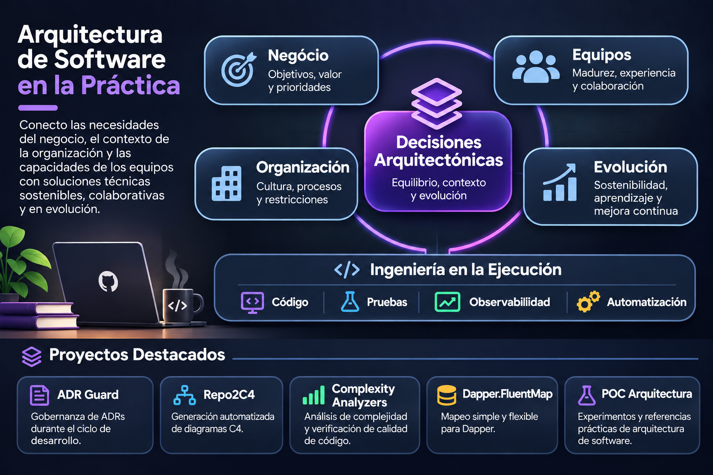

[Português](README.md) | [English](README.en.md) | **Español (Latinoamérica)**

  

# Rodrigo de Oliveira

**Arquitecto de Software · Sistemas Distribuidos · .NET · Cloud**

*Arquitecto de software con participación directa en .NET, sistemas distribuidos, cloud, gobernanza de arquitectura y herramientas de código abierto para desarrolladores.*

Desde hace más de 20 años trabajo en el desarrollo y la evolución de sistemas empresariales, con foco en arquitectura de software, integraciones y modernización de aplicaciones. Busco equilibrar las necesidades del negocio, las decisiones técnicas y la realidad operativa de los sistemas.

Aquí comparto herramientas, bibliotecas y laboratorios de código abierto que ayudan a convertir decisiones de arquitectura y gobernanza en código, pruebas y automatización.

  <picture>
    <source
      media="(max-width: 767px)"
      srcset="assets/profile/software-architecture-in-practice.es.mobile.png"
    />
    
  </picture>

**Enlaces profesionales**

- [Portafolio profesional](https://rodri-oliveira-dev.github.io/)
- [LinkedIn](https://www.linkedin.com/in/rodri-oliveira-dev)
- [Café com código](https://www.linkedin.com/newsletters/caf%C3%A9-com-c%C3%B3digo-6880618748047314945)
- [NuGet](https://www.nuget.org/profiles/rodri-oliveira-dev)

---

## Proyectos destacados

Herramientas, bibliotecas y laboratorios que conectan las decisiones de arquitectura con la implementación y la operación.

### [ADR Guard](https://github.com/rodri-oliveira-dev/adr-guard)

*Herramienta de gobernanza de arquitectura*

Ayuda a los equipos a mantener registros de decisiones consistentes y trazables. La CLI en .NET crea, valida e indexa ADRs; los análisis opcionales de impacto y desviaciones arquitectónicas se basan en evidencia acotada, sin sustituir el criterio humano. El [estudio de caso](https://rodri-oliveira-dev.github.io/es/case-studies/adr-guard/) detalla las decisiones y sus implicaciones.

### [Dapper.FluentMap](https://github.com/rodri-oliveira-dev/Dapper-FluentMap)

*Biblioteca .NET*

Resuelve el mapeo entre objetos .NET y columnas cuando las convenciones de Dapper no son suficientes, sin agregar atributos a los modelos. La evolución de la biblioteca combina una API fluida, extensibilidad y compatibilidad con aplicaciones existentes, y demuestra el mantenimiento responsable de APIs públicas y la modernización incremental. El [estudio de caso](https://rodri-oliveira-dev.github.io/es/case-studies/dapper-fluentmap/) analiza los límites de esta abstracción.

### [Repo2C4](https://github.com/rodri-oliveira-dev/Repo2C4)

*Herramienta de documentación de arquitectura*

Reduce la divergencia entre el código y los diagramas al transformar evidencia acotada de repositorios .NET en documentación C4/LikeC4 que puede revisarse. El flujo separa las observaciones de las hipótesis y exige aplicar los cambios de forma explícita, lo que demuestra análisis estático, generación determinista e integración con agentes mediante MCP.

### [POC Arquitetura](https://github.com/rodri-oliveira-dev/poc-arquitetura)

*Laboratorio de sistemas distribuidos*

Permite reproducir decisiones sobre consistencia eventual, manejo de fallas y trazabilidad en una base de servicios distribuidos en .NET. Implementa DDD, integración asíncrona con Kafka y Outbox, pruebas y runbooks, y mantiene las propuestas sin evidencia marcadas explícitamente como pendientes.

### [ReliableWebhooks](https://github.com/rodri-oliveira-dev/ReliableWebhooks)

*Biblioteca .NET para integraciones*

Aborda las fallas, la concurrencia y la duplicación en la entrega de webhooks salientes. Los IDs estables hacen que la puesta en cola sea idempotente, mientras que las concesiones temporales y los reintentos permiten una entrega at-least-once con almacenamiento duradero proporcionado por la aplicación; el destinatario aún debe tolerar duplicados. El [estudio de caso](https://rodri-oliveira-dev.github.io/es/case-studies/reliable-webhooks/) examina estas garantías y sus límites.

### [ComplexityAnalysis.Analyzers](https://github.com/rodri-oliveira-dev/complexity-analyzers)

*Herramienta de análisis estático*

Identifica patrones costosos y regresiones de complejidad antes de la ejecución. El analizador Roslyn estima Big-O cuando existe evidencia suficiente, aplica métricas configurables durante la compilación y en el IDE, e informa un resultado indeterminado en lugar de inferir más de lo que permite el código.

Otros trabajos: [Repo Control Center](https://github.com/rodri-oliveira-dev/repo-status-dashboard), un panel de CI, versiones publicadas, seguridad y estado de los repositorios, y la [lista completa de repositorios](https://github.com/rodri-oliveira-dev?tab=repositories).

---

## Contribuciones de código abierto

Algunas contribuciones integradas que representan correcciones, mantenimiento y seguridad en bases de código existentes:

- **Ocelot — [PR #2420](https://github.com/ThreeMammals/Ocelot/pull/2420):** corrigió el mapeo de tiempos de espera del servicio de destino a HTTP 504 según la RFC 9110, manteniendo la cancelación del cliente y el comportamiento de QoS, con pruebas unitarias y de aceptación.
- **MySqlConnector — [PR #1675](https://github.com/mysql-net/MySqlConnector/pull/1675):** eliminó la detección obsoleta de Azure MySQL Single Server, mantuvo la ruta de AWS RDS Proxy y simplificó la lógica de conexión.
- **OpenCNPJ — [PR #75](https://github.com/Hitmasu/OpenCNPJ/pull/75):** centralizó las descargas externas en un flujo con tiempos de espera, límites de tamaño, archivos temporales y limpieza en caso de fallas, acompañado de pruebas y validación en CI.

El [catálogo completo de contribuciones de código abierto](docs/open-source-contributions.es.md) mantiene actualizados automáticamente los demás Pull Requests y sus estados.

## Gobernanza como código

En el repositorio **[.github](https://github.com/rodri-oliveira-dev/.github)** reúno políticas y automatizaciones reutilizables: estándares de contribución y seguridad, inventario de proyectos .NET, detección de secretos y distribución controlada de skills para agentes. Los cambios pasan por Pull Request y cada repositorio conserva la autonomía para adoptar sus propias reglas.

## Mi visión de la arquitectura

Mi forma de entender la arquitectura de software se fue construyendo a lo largo de más de dos décadas trabajando en desarrollo. Esa experiencia me enseñó que no basta con que una solución sea técnicamente correcta. También tiene que responder a las necesidades del negocio, adaptarse a la realidad de la organización y funcionar para las personas que la van a construir y mantener.

No creo que la arquitectura deba definirse de manera aislada y luego imponerse a los equipos. Para tomar buenas decisiones, primero hay que conocer cómo trabaja la empresa, la experiencia de los equipos, las limitaciones que enfrentan y los objetivos que buscan alcanzar. A partir de ese contexto, prefiero construir las decisiones en conjunto, atendiendo las necesidades actuales sin perder de vista la evolución futura.

Para mí, el trabajo del arquitecto no se limita a diseñar soluciones. También consiste en acompañar a los equipos en sus decisiones técnicas, compartir conocimiento y crear las condiciones para que los sistemas puedan evolucionar de manera sostenible.

## Publicaciones y contenido técnico

Escribo sobre arquitectura de software, DDD y desarrollo .NET, principalmente acerca de decisiones y problemas encontrados en la práctica.

- **[Café com código](https://www.linkedin.com/newsletters/caf%C3%A9-com-c%C3%B3digo-6880618748047314945)** — boletín sobre arquitectura e ingeniería de software.
