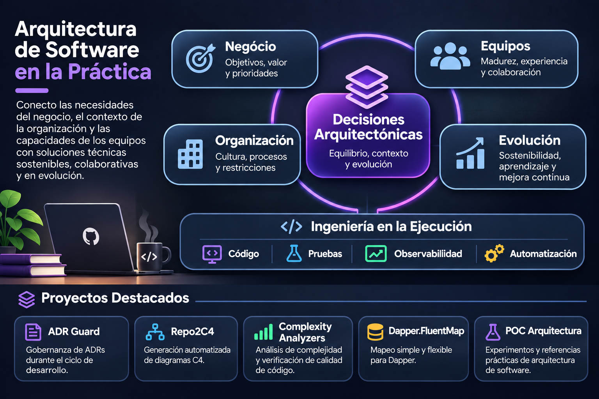

[Português](README.md) | [English](README.en.md) | **Español (Latinoamérica)**

  

# Rodrigo de Oliveira

**Arquitecto de Software · Sistemas Distribuidos · .NET · Cloud**
Empecé mi carrera desarrollando software, principalmente con .NET. Durante más de 20 años he trabajado con sistemas empresariales, integraciones y modernización de aplicaciones heredadas. Hoy soy arquitecto de software en CI&T y trabajo en soluciones de crédito y préstamos. Acompaño a dos equipos de ingeniería y colaboro con producto, líderes técnicos y otros arquitectos.

Una experiencia importante en mi trayectoria fue la modernización de un sistema del sector asegurador. Definí la arquitectura para trasladar reglas de negocio que estaban en procedimientos almacenados a microservicios, establecí las responsabilidades de cada servicio y acompañé la implementación hasta su puesta en producción. El monitoreo mostró una disminución en la cantidad de transacciones con errores después del cambio.

También he trabajado con sistemas críticos de alto volumen transaccional, investigado incidentes de integración en producción y participado en la corrección de contratos y comunicación entre APIs. Mi experiencia incluye implementar aplicaciones y servicios en Google Cloud y colaborar con el Centro de Excelencia de Arquitectura en estándares compartidos de APIs e integraciones. También ejercí como líder técnico y Career Advisor, acompañé el desarrollo de otros profesionales y participé en la adopción de herramientas de IA para el desarrollo de software.

En este perfil comparto bibliotecas, herramientas y laboratorios que mantengo para probar ideas y compartir lo que aprendo. Me gusta seguir cerca del código, porque ayuda a que las decisiones arquitectónicas tengan sentido en la práctica.

  <picture>
    <source
      media="(max-width: 767px)"
      srcset="assets/profile/software-architecture-in-practice.es.mobile.png"
    />
    
  </picture>

**Arquitectura de software en la práctica:** decisiones orientadas por el negocio, los equipos, la organización y la evolución de los sistemas, respaldadas por código, pruebas, observabilidad y automatización. Los proyectos ilustrados son ADR Guard, Repo2C4, Complexity Analyzers, Dapper.FluentMap y POC Arquitetura.

**Enlaces profesionales**

- 🧭 [Portafolio profesional](https://rodri-oliveira-dev.github.io/)
- 📄 [Currículum](https://rodri-oliveira-dev.github.io/es/curriculo/)
- 🤝 [Servicios de consultoría](https://rodri-oliveira-dev.github.io/es/servicios/)
- 💼 [LinkedIn](https://www.linkedin.com/in/rodri-oliveira-dev)
- ☕ [Café com código](https://www.linkedin.com/newsletters/caf%C3%A9-com-c%C3%B3digo-6880618748047314945)
- 📦 [NuGet](https://www.nuget.org/profiles/rodri-oliveira-dev)

---

## Proyectos destacados

Herramientas, bibliotecas y laboratorios que conectan las decisiones de arquitectura con la implementación y la operación.

### [ADR Guard](https://github.com/rodri-oliveira-dev/adr-guard)

*Herramienta de gobernanza de arquitectura*

Ayuda a los equipos a mantener registros de decisiones arquitectónicas (ADR) consistentes y rastreables. Su CLI en .NET permite crear, validar e indexar estos registros. Los análisis opcionales de impacto y desviaciones arquitectónicas se basan en evidencia verificable, sin reemplazar el criterio profesional. Un [servidor MCP independiente y de solo lectura](https://github.com/rodri-oliveira-dev/adr-guard/blob/main/docs/mcp.md) ofrece herramientas a agentes compatibles, mientras que las [Agent Skills](https://github.com/rodri-oliveira-dev/adr-guard/blob/main/docs/skills/README.md) orientan su uso sin delegar decisiones arquitectónicas. El [estudio de caso](https://rodri-oliveira-dev.github.io/es/case-studies/adr-guard/) explica las decisiones tomadas y sus implicaciones.

### [Dapper.FluentMap](https://github.com/rodri-oliveira-dev/Dapper-FluentMap)

*Biblioteca .NET*

Resuelve el mapeo entre objetos .NET y columnas de bases de datos cuando las convenciones de Dapper no son suficientes, sin agregar atributos a los modelos. Su evolución busca combinar una API fluida y extensible con la compatibilidad de las aplicaciones existentes, preservando los contratos públicos durante una modernización gradual. El [estudio de caso](https://rodri-oliveira-dev.github.io/es/case-studies/dapper-fluentmap/) analiza los límites de esta abstracción.

### [Repo2C4](https://github.com/rodri-oliveira-dev/Repo2C4)

*Herramienta de documentación de arquitectura*

Reduce el riesgo de que el código y los diagramas pierdan consistencia al convertir evidencia verificable de repositorios .NET en documentación C4/LikeC4 que se puede revisar. El proceso distingue las observaciones de las hipótesis y requiere aplicar los cambios de forma explícita. Combina análisis estático, generación determinista e integración con agentes mediante MCP.

### [POC Arquitetura](https://github.com/rodri-oliveira-dev/poc-arquitetura)

*Laboratorio de sistemas distribuidos*

Permite explorar decisiones sobre consistencia eventual, manejo de fallas y trazabilidad mediante escenarios reproducibles con servicios distribuidos en .NET. Reúne DDD, integración asíncrona con Kafka y el patrón Outbox, pruebas y guías operativas (runbooks). Las propuestas que todavía no cuentan con evidencia en el código se identifican como pendientes.

### [ReliableWebhooks](https://github.com/rodri-oliveira-dev/ReliableWebhooks)

*Biblioteca .NET para integraciones*

Aborda las fallas, la concurrencia y las entregas duplicadas de webhooks salientes. Los identificadores estables permiten agregar eventos a la cola de forma idempotente. La asignación temporal del trabajo (leases) y los reintentos respaldan una entrega de al menos una vez (at-least-once), siempre que la aplicación proporcione almacenamiento duradero y que el sistema receptor tolere duplicados. El [estudio de caso](https://rodri-oliveira-dev.github.io/es/case-studies/reliable-webhooks/) examina estas garantías y sus límites.

### [ComplexityAnalysis.Analyzers](https://github.com/rodri-oliveira-dev/complexity-analyzers)

*Herramienta de análisis estático*

Identifica patrones de alto costo computacional y posibles regresiones de complejidad antes de ejecutar el código. El analizador basado en Roslyn estima la complejidad Big-O cuando hay suficiente evidencia, aplica métricas configurables durante la compilación y en el IDE, y devuelve un resultado indeterminado cuando el código no permite una conclusión fundamentada.

Otros proyectos incluyen [Repo Control Center](https://github.com/rodri-oliveira-dev/repo-status-dashboard), un panel para consultar la integración continua (CI), las versiones publicadas, la seguridad y el estado general de los repositorios. También puedes explorar la [lista completa de repositorios](https://github.com/rodri-oliveira-dev?tab=repositories).

---

## Contribuciones de código abierto

Estas son algunas de mis contribuciones incorporadas en proyectos de terceros, centradas en correcciones, mantenimiento y seguridad:

- **Ocelot — [PR #2420](https://github.com/ThreeMammals/Ocelot/pull/2420):** corrigió el mapeo de los tiempos de espera del servicio de destino a HTTP 504, conforme a la RFC 9110, sin alterar la cancelación del cliente ni el comportamiento de QoS. Incluyó pruebas unitarias y de aceptación.
- **MySqlConnector — [PR #1675](https://github.com/mysql-net/MySqlConnector/pull/1675):** eliminó la detección obsoleta de Azure MySQL Single Server, conservó la compatibilidad con AWS RDS Proxy y simplificó la lógica de conexión.
- **OpenCNPJ — [PR #75](https://github.com/Hitmasu/OpenCNPJ/pull/75):** centralizó las descargas externas e incorporó tiempos de espera, límites de tamaño, archivos temporales y limpieza ante errores, con pruebas y validación en CI.

El [catálogo completo de contribuciones de código abierto](docs/open-source-contributions.es.md) reúne los demás pull requests y actualiza automáticamente sus estados.

## Gobernanza como código

En el repositorio **[.github](https://github.com/rodri-oliveira-dev/.github)** reúno políticas y automatizaciones reutilizables: estándares de contribución y seguridad, inventario de proyectos .NET, detección de secretos y distribución controlada de skills para agentes. Los cambios se revisan mediante pull requests y cada repositorio conserva la autonomía para adoptar sus propias reglas.

## Mi visión de la arquitectura

Después de tantos años desarrollando software, aprendí que una decisión de arquitectura también tiene que funcionar después de su puesta en producción. Afecta a quienes desarrollan, operan y mantienen el sistema.

Por eso, prefiero empezar por el problema y las limitaciones reales. Converso sobre alternativas con los equipos, evalúo los trade-offs y trato de evitar complejidad que no aporte valor. No creo en una arquitectura diseñada de forma aislada y entregada como un conjunto de reglas.

Me gusta seguir cerca del código y de las personas que lo mantienen. Eso me ayuda a revisar mis decisiones y aprender de lo que pasa en producción.

## Publicaciones y contenido técnico

Escribo sobre arquitectura de software, DDD y desarrollo .NET, a partir de decisiones y problemas que surgen en la práctica.

- **[Café com código](https://www.linkedin.com/newsletters/caf%C3%A9-com-c%C3%B3digo-6880618748047314945)** — boletín sobre arquitectura e ingeniería de software.

[Declaración de accesibilidad](ACCESSIBILITY.md#español)
