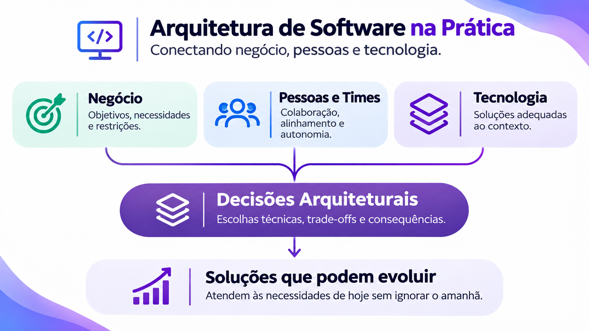

**Português** | [English](README.en.md) | [Español (Latinoamérica)](README.es.md)
<!-- cspell:words Español Latinoamérica -->

  

# Rodrigo de Oliveira

**Arquiteto de Software · Sistemas Distribuídos · .NET · Cloud**
Comecei minha carreira desenvolvendo software, principalmente com .NET. Depois de mais de 20 anos trabalhando com sistemas corporativos, integrações e modernização de aplicações, hoje atuo como arquiteto de software na CI&T. Meu trabalho atual é voltado a soluções de crédito e empréstimos. Apoio dois times de engenharia e trabalho com profissionais de produto, lideranças técnicas e outros arquitetos.

Uma experiência importante na minha trajetória foi a modernização de um sistema do setor de seguros. Defini a arquitetura para levar regras de negócio antes concentradas em stored procedures para microsserviços, estabeleci as responsabilidades entre os serviços e acompanhei a implantação em produção. O monitoramento mostrou uma redução na quantidade de transações com erro após a mudança.

Também trabalhei com sistemas críticos de alto volume transacional, investiguei falhas de integração em produção e participei de correções em contratos e na comunicação entre APIs. Minha experiência inclui implementar aplicações e serviços na Google Cloud e colaborar com o Centro de Excelência de Arquitetura na definição de padrões de APIs e integrações. Atuei ainda como líder técnico e Career Advisor, acompanhei o desenvolvimento de outros profissionais e participei da adoção de ferramentas de IA no desenvolvimento de software.

Aqui compartilho bibliotecas, ferramentas e laboratórios que mantenho para experimentar ideias e dividir o que aprendo. Gosto de continuar próximo do código, porque isso ajuda a tomar decisões que funcionem também na prática.

  <picture>
    <source
      media="(max-width: 767px)"
      srcset="assets/profile/software-architecture-in-practice.pt.mobile.png"
    />
    
  </picture>

**Links profissionais**

- 🧭 [Portfólio profissional](https://rodri-oliveira-dev.github.io/)
- 📄 [Currículo (em português)](https://rodri-oliveira-dev.github.io/curriculo/)
- 🤝 [Serviços de consultoria](https://rodri-oliveira-dev.github.io/servicos/)
- 💼 [LinkedIn](https://www.linkedin.com/in/rodri-oliveira-dev)
- ☕ [Café com código](https://www.linkedin.com/newsletters/caf%C3%A9-com-c%C3%B3digo-6880618748047314945)
- 📦 [NuGet](https://www.nuget.org/profiles/rodri-oliveira-dev)

---

## Projetos selecionados

Ferramentas, bibliotecas e laboratórios que conectam decisões de arquitetura à implementação e à operação.

### [ADR Guard](https://github.com/rodri-oliveira-dev/adr-guard)

*Ferramenta de governança arquitetural*

Ajuda equipes a manter registros de decisão consistentes e rastreáveis. A CLI em .NET cria, valida e indexa ADRs. As análises opcionais de impacto e desvios arquiteturais se baseiam em evidências verificáveis, sem substituir a avaliação humana. Um [servidor MCP independente](https://github.com/rodri-oliveira-dev/adr-guard/blob/main/docs/mcp.md) oferece ferramentas de leitura para agentes compatíveis, e as [Agent Skills](https://github.com/rodri-oliveira-dev/adr-guard/blob/main/docs/skills/README.md) orientam seu uso sem delegar decisões arquiteturais. O [estudo de caso](https://rodri-oliveira-dev.github.io/case-studies/adr-guard/) detalha decisões e trade-offs.

### [Dapper.FluentMap](https://github.com/rodri-oliveira-dev/Dapper-FluentMap)

*Biblioteca .NET*

Resolve mapeamentos entre objetos .NET e colunas do banco de dados quando as convenções do Dapper não bastam, sem adicionar atributos aos modelos. Sua evolução busca conciliar uma API fluente e extensível com a compatibilidade de aplicações existentes, preservando contratos públicos durante a modernização incremental. O [estudo de caso](https://rodri-oliveira-dev.github.io/case-studies/dapper-fluentmap/) discute os limites dessa abstração.

### [Repo2C4](https://github.com/rodri-oliveira-dev/Repo2C4)

*Ferramenta de documentação arquitetural*

Reduz o risco de divergência entre código e diagramas ao transformar evidências verificáveis de repositórios .NET em documentação C4/LikeC4 que pode ser revisada. O processo separa observações de hipóteses e exige a aplicação explícita das mudanças. Combina análise estática, geração determinística e integração com agentes via MCP.

### [POC Arquitetura](https://github.com/rodri-oliveira-dev/poc-arquitetura)

*Laboratório de sistemas distribuídos*

Explora decisões sobre consistência eventual, falhas e rastreabilidade por meio de cenários reproduzíveis com serviços distribuídos em .NET. Reúne DDD, integração assíncrona com Kafka e Outbox, testes e runbooks. As propostas que ainda não têm evidências permanecem identificadas como pendentes.

### [ReliableWebhooks](https://github.com/rodri-oliveira-dev/ReliableWebhooks)

*Biblioteca .NET para integração*

Trata falhas, concorrência e duplicidade na entrega de webhooks de saída. IDs estáveis tornam o enfileiramento idempotente. Leases (posse temporária do trabalho) e novas tentativas dão suporte à entrega at-least-once, desde que a aplicação forneça armazenamento durável e o destinatário tolere duplicatas. O [estudo de caso](https://rodri-oliveira-dev.github.io/case-studies/reliable-webhooks/) examina essas garantias e seus limites.

### [ComplexityAnalysis.Analyzers](https://github.com/rodri-oliveira-dev/complexity-analyzers)

*Ferramenta de análise estática*

Identifica padrões de alto custo computacional e possíveis regressões de complexidade durante a análise do código. O analisador Roslyn estima Big-O quando há evidência suficiente, aplica métricas configuráveis na compilação e na IDE e retorna resultado indeterminado em vez de inferir além do que o código permite.

Outros trabalhos incluem o [Repo Control Center](https://github.com/rodri-oliveira-dev/repo-status-dashboard), painel para acompanhar CI, versões, segurança e saúde dos repositórios. Veja também a [lista completa de repositórios](https://github.com/rodri-oliveira-dev?tab=repositories).

---

## Contribuições open source

Algumas contribuições incorporadas a projetos de terceiros, voltadas a correções, manutenção e segurança:

- **Ocelot — [PR #2420](https://github.com/ThreeMammals/Ocelot/pull/2420):** corrigiu o mapeamento de timeouts do serviço de destino para HTTP 504 conforme a RFC 9110, preservando cancelamento do cliente e comportamento de QoS, com testes unitários e de aceitação.
- **MySqlConnector — [PR #1675](https://github.com/mysql-net/MySqlConnector/pull/1675):** removeu a detecção obsoleta do Azure MySQL Single Server, preservando o caminho do AWS RDS Proxy e simplificando a lógica de conexão.
- **OpenCNPJ — [PR #75](https://github.com/Hitmasu/OpenCNPJ/pull/75):** centralizou downloads externos em um fluxo com timeouts, limites de tamanho, arquivos temporários e limpeza em falhas, acompanhado por testes e validação em CI.

O [catálogo completo de contribuições open source](docs/open-source-contributions.md) reúne os demais pull requests e acompanha automaticamente o estado de cada um.

## Governança como código

No repositório **[.github](https://github.com/rodri-oliveira-dev/.github)**, reúno políticas e automações compartilháveis: padrões de contribuição e segurança, inventário de projetos .NET, verificação de segredos e distribuição controlada de skills para agentes. As mudanças passam por revisão em pull requests, e cada repositório mantém autonomia para adotar suas regras.

## Como vejo a arquitetura

Trabalhar muitos anos com desenvolvimento me ensinou que uma decisão de arquitetura precisa funcionar também depois da implantação. Ela afeta quem desenvolve, quem opera e quem precisa evoluir o sistema.

Por isso, prefiro começar pelo problema e pelas restrições reais. Discuto alternativas com os times, avalio os trade-offs e tento evitar complexidade que não traga benefício. Não acredito em arquitetura decidida isoladamente e entregue como uma regra pronta.

Gosto de continuar próximo do código e das pessoas que o mantêm. É assim que consigo revisar minhas decisões e aprender com o que acontece em produção.

## Publicações e conteúdo técnico

Escrevo sobre arquitetura de software, DDD e desenvolvimento .NET, com foco nas decisões e nos problemas encontrados na prática.

- **[Café com código](https://www.linkedin.com/newsletters/caf%C3%A9-com-c%C3%B3digo-6880618748047314945)** — newsletter sobre arquitetura e engenharia de software.
