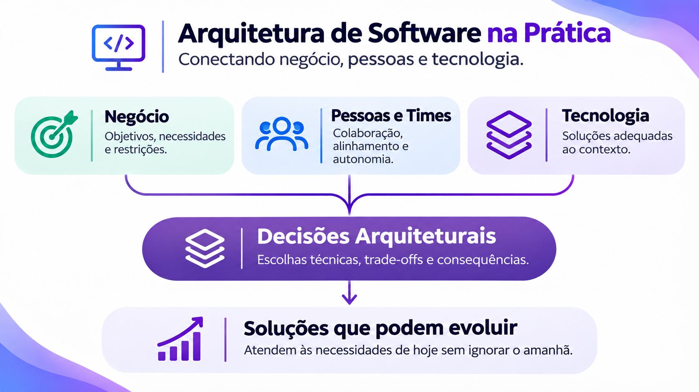

**Português** | [English](README.en.md) | [Español (Latinoamérica)](README.es.md)
<!-- cspell:words Español Latinoamérica -->

  

# Rodrigo de Oliveira

**Arquiteto de Software · Sistemas Distribuídos · .NET · Cloud**

*Experiência prática com .NET, sistemas distribuídos, plataformas em nuvem, governança arquitetural e ferramentas open source.*

Minha trajetória começou no desenvolvimento de software e, ao longo de mais de 20 anos, passou por integrações e modernização de sistemas corporativos até chegar à arquitetura. Hoje, atuo na arquitetura de soluções para os setores financeiro e segurador, com responsabilidade arquitetural por dois times de engenharia e colaboração com profissionais de produto, lideranças técnicas e outros arquitetos.

Participei da modernização de funcionalidades legadas para microsserviços, do levantamento inicial à implantação em produção, e contribuo para revisões técnicas e padrões no Centro de Excelência de Arquitetura. Também atuei como liderança técnica e Career Advisor, apoiando a mentoria e o desenvolvimento de profissionais, e participei da adoção de ferramentas de IA no desenvolvimento de novos sistemas.

Aqui compartilho bibliotecas, ferramentas e laboratórios open source que desenvolvo para explorar como decisões de arquitetura se refletem em código, testes e automação.

  <picture>
    <source
      media="(max-width: 767px)"
      srcset="assets/profile/software-architecture-in-practice.pt.mobile.png"
    />
    
  </picture>

**Links profissionais**

- [Portfólio profissional](https://rodri-oliveira-dev.github.io/)
- [Currículo (em português)](https://rodri-oliveira-dev.github.io/curriculo/)
- [Serviços de consultoria](https://rodri-oliveira-dev.github.io/servicos/)
- [LinkedIn](https://www.linkedin.com/in/rodri-oliveira-dev)
- [Café com código](https://www.linkedin.com/newsletters/caf%C3%A9-com-c%C3%B3digo-6880618748047314945)
- [NuGet](https://www.nuget.org/profiles/rodri-oliveira-dev)

---

## Projetos selecionados

Ferramentas, bibliotecas e laboratórios que conectam decisões de arquitetura à implementação e à operação.

### [ADR Guard](https://github.com/rodri-oliveira-dev/adr-guard)

*Ferramenta de governança arquitetural*

Ajuda equipes a manter registros de decisão consistentes e rastreáveis. A CLI em .NET cria, valida e indexa ADRs. As análises opcionais de impacto e desvios arquiteturais se baseiam em evidências verificáveis, sem substituir a avaliação humana. Um [servidor MCP independente](https://github.com/rodri-oliveira-dev/adr-guard/blob/main/docs/mcp.md) oferece ferramentas de leitura para agentes compatíveis, e as [Agent Skills](https://github.com/rodri-oliveira-dev/adr-guard/blob/main/docs/skills/README.md) orientam seu uso sem delegar decisões arquiteturais. O [estudo de caso](https://rodri-oliveira-dev.github.io/case-studies/adr-guard/) detalha decisões e trade-offs.

### [Dapper.FluentMap](https://github.com/rodri-oliveira-dev/Dapper-FluentMap)

*Biblioteca .NET*

Resolve mapeamentos entre objetos .NET e colunas do banco de dados quando as convenções do Dapper não bastam, sem adicionar atributos aos modelos. Sua evolução busca conciliar uma API fluente e extensível com a compatibilidade de aplicações existentes, preservando contratos públicos durante a modernização incremental. O [estudo de caso](https://rodri-oliveira-dev.github.io/case-studies/dapper-fluentmap/) discute os limites dessa abstração.

### [Repo2C4](https://github.com/rodri-oliveira-dev/Repo2C4)

*Ferramenta de documentação arquitetural*

Reduz o risco de divergência entre código e diagramas ao transformar evidências verificáveis de repositórios .NET em documentação C4/LikeC4 que pode ser revisada. O processo separa observações de hipóteses e exige a aplicação explícita das mudanças. Combina análise estática, geração determinística e integração com agentes via MCP.

### [POC Arquitetura](https://github.com/rodri-oliveira-dev/poc-arquitetura)

*Laboratório de sistemas distribuídos*

Explora decisões sobre consistência eventual, falhas e rastreabilidade por meio de cenários reproduzíveis com serviços distribuídos em .NET. Reúne DDD, integração assíncrona com Kafka e Outbox, testes e runbooks. As propostas que ainda não têm evidências permanecem identificadas como pendentes.

### [ReliableWebhooks](https://github.com/rodri-oliveira-dev/ReliableWebhooks)

*Biblioteca .NET para integração*

Trata falhas, concorrência e duplicidade na entrega de webhooks de saída. IDs estáveis tornam o enfileiramento idempotente. Leases (posse temporária do trabalho) e novas tentativas dão suporte à entrega at-least-once, desde que a aplicação forneça armazenamento durável e o destinatário tolere duplicatas. O [estudo de caso](https://rodri-oliveira-dev.github.io/case-studies/reliable-webhooks/) examina essas garantias e seus limites.

### [ComplexityAnalysis.Analyzers](https://github.com/rodri-oliveira-dev/complexity-analyzers)

*Ferramenta de análise estática*

Identifica padrões de alto custo computacional e possíveis regressões de complexidade durante a análise do código. O analisador Roslyn estima Big-O quando há evidência suficiente, aplica métricas configuráveis na compilação e na IDE e retorna resultado indeterminado em vez de inferir além do que o código permite.

Outros trabalhos incluem o [Repo Control Center](https://github.com/rodri-oliveira-dev/repo-status-dashboard), painel para acompanhar CI, versões, segurança e saúde dos repositórios. Veja também a [lista completa de repositórios](https://github.com/rodri-oliveira-dev?tab=repositories).

---

## Contribuições open source

Algumas contribuições incorporadas a projetos de terceiros, voltadas a correções, manutenção e segurança:

- **Ocelot — [PR #2420](https://github.com/ThreeMammals/Ocelot/pull/2420):** corrigiu o mapeamento de timeouts do serviço de destino para HTTP 504 conforme a RFC 9110, preservando cancelamento do cliente e comportamento de QoS, com testes unitários e de aceitação.
- **MySqlConnector — [PR #1675](https://github.com/mysql-net/MySqlConnector/pull/1675):** removeu a detecção obsoleta do Azure MySQL Single Server, preservando o caminho do AWS RDS Proxy e simplificando a lógica de conexão.
- **OpenCNPJ — [PR #75](https://github.com/Hitmasu/OpenCNPJ/pull/75):** centralizou downloads externos em um fluxo com timeouts, limites de tamanho, arquivos temporários e limpeza em falhas, acompanhado por testes e validação em CI.

O [catálogo completo de contribuições open source](docs/open-source-contributions.md) reúne os demais pull requests e acompanha automaticamente o estado de cada um.

## Governança como código

No repositório **[.github](https://github.com/rodri-oliveira-dev/.github)**, reúno políticas e automações compartilháveis: padrões de contribuição e segurança, inventário de projetos .NET, verificação de segredos e distribuição controlada de skills para agentes. As mudanças passam por revisão em pull requests, e cada repositório mantém autonomia para adotar suas regras.

## Como vejo a arquitetura

Minha forma de pensar arquitetura vem de mais de duas décadas atuando no desenvolvimento de software. Essa experiência me ensinou que não basta uma solução ser tecnicamente adequada. Ela também precisa fazer sentido para o negócio, para a organização e para as pessoas que vão construí-la e mantê-la.

Não vejo a arquitetura como algo definido isoladamente por um arquiteto e depois imposto às equipes. Por isso, procuro compreender o contexto da empresa, a maturidade dos times, as limitações existentes e os objetivos a alcançar. A partir dessa compreensão, busco construir decisões em conjunto, equilibrando as necessidades atuais e as possibilidades de evolução.

Para mim, o papel do arquiteto não é apenas desenhar soluções, mas ajudar as equipes a tomar boas decisões técnicas, compartilhar conhecimento e criar condições para que os sistemas possam evoluir de maneira sustentável.

## Publicações e conteúdo técnico

Escrevo sobre arquitetura de software, DDD e desenvolvimento .NET, com foco nas decisões e nos problemas encontrados na prática.

- **[Café com código](https://www.linkedin.com/newsletters/caf%C3%A9-com-c%C3%B3digo-6880618748047314945)** — newsletter sobre arquitetura e engenharia de software.
